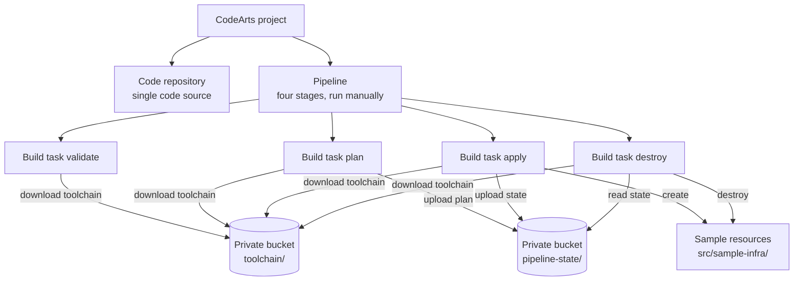

# Four-Stage Terraform Infrastructure Pipeline

[](LICENSE)
[](https://www.huaweicloud.com)

A four-stage Terraform pipeline built on code hosting, build and orchestration services: validate,
plan, apply and destroy. The toolchain is not preinstalled on the build agent; it is fetched from a
private bucket and initialised offline. It suits teams that want Terraform changes under a controlled
process without pinning tool versions into the build image.

## Overview

Putting Terraform into a pipeline has three places where it typically goes wrong: **where the
toolchain comes from**, **how stages hand over to each other**, and **how destroy is scoped**. This
sample answers each explicitly:

- **The toolchain comes from a private bucket** — the Terraform and provider archives are stored in a
  private bucket. The build agent downloads them, unpacks them, generates a temporary plugin mirror
  configuration under `registry.terraform.io/huaweicloud/huaweicloud`, and initialises with
  `-plugin-dir`. Nothing touches the public network, and the version is declared by the repository.
- **Stages hand over through object keys** — the plan stage writes the plan file to a fixed object
  key and the apply stage reads it; the apply stage writes state back to another fixed key and the
  destroy stage reads it. This makes the inter-stage contract explicit: two object names.
- **Destroy only cleans the sample infrastructure** — the sample infrastructure lives in its own
  directory and state, so destroy touches only it. The platform resources (project, repository, build
  tasks, pipeline, private bucket) stay until a human confirms release.

**What it solves**: it turns "Terraform change from commit to applied resource" into a controlled
flow that is deployable and verifiable in one pass.

**Who it is for**: platform engineering teams that need an approval and execution flow for
Terraform, and organisations that want infrastructure changes inside their existing development
process without maintaining a toolchain in the build image.

## Table of Contents

- [Architecture](#architecture)
- [Highlights](#highlights)
- [Cloud Services](#cloud-services)
- [Prerequisites](#prerequisites)
- [Quick Start](#quick-start)
- [Step-by-step Deployment](#step-by-step-deployment)
- [Usage and Verification](#usage-and-verification)
- [Repository Layout](#repository-layout)
- [Clean Up](#clean-up)
- [Further Reading](#further-reading)
- [FAQ](#faq)
- [License](#license)
- [Contact](#contact)

## Architecture



All four stages share one code source and one build agent configuration; they differ only in which
command runs and which objects are read or written.

| Layer | Service | Description |
|-|-|-|
| Project and source | CodeArts project, CodeArts repository | Code source and pipeline container |
| Orchestration | CodeArts Pipeline | Four stages in order, manual run, concurrency 1 |
| Execution | CodeArts Build | Four build tasks on `x86-64` |
| Toolchain and state | Object Storage Service | Private bucket holding two toolchain objects and two state objects |
| Sample resources | LTS | One log group, used to prove the stage chain works |

## Highlights

- **The toolchain version is declared by the repository** — no reliance on the build image; changing
  the version means replacing two archives in the bucket.
- **Offline initialisation** — the build agent only fetches from the private bucket and generates a
  temporary plugin mirror configuration; it never reaches the public network.
- **An explicit stage contract** — plan and state are handed over through fixed object keys, so a
  replay with the same objects reproduces the same decision.
- **Bounded destroy** — the sample infrastructure has its own directory and state, so destroy never
  touches the platform stack.
- **Manual runs prevent accidents** — otherwise "initialise the repository" would itself trigger the
  next run.
- **One stage template** — the shared part (fetch toolchain, unpack, generate the mirror
  configuration) exists once; differences are expressed as parameters.

## Cloud Services

| Service | Role in this sample | Terraform resource |
|-|-|-|
| CodeArts | Project, code repository, four build tasks, one pipeline | `huaweicloud_codearts_project`, `huaweicloud_codearts_repository`, `huaweicloud_codearts_build_task`, `huaweicloud_codearts_pipeline` |
| Object Storage Service | Private bucket and two toolchain objects | `huaweicloud_obs_bucket`, `huaweicloud_obs_bucket_object` |
| LTS | Sample resource: one log group | Declared in `src/sample-infra/` |

Release these resources when the sample is no longer needed, to avoid leaving them behind.

## Prerequisites

**Account and permissions**

- An account that has completed real-name verification, with `cn-north-4` available (this sample was
  verified there).
- Permission to enable and operate CodeArts projects, repositories, builds, pipelines and Object
  Storage.
- Access Key ID and Secret Access Key from the "My Credentials" page, supplied to the deployment
  shell. Never write credentials into code or commit them.

**Tools and versions**

- Terraform CLI `>= 1.9 and < 2.0`, huaweicloud provider `1.95.0`.
- Python 3.9 or later for the initialisation and verification scripts.

**Offline toolchain**

- Two archives ship with the repository: Terraform `1.9.8` (linux amd64) and huaweicloud provider
  `1.95.0` (linux amd64). They live in `src/dist/` and the root project uploads them to the private
  bucket.

**Region and naming constraints**

- `var.prefix` derives every resource name: it must start with a lowercase letter, may contain digits
  and hyphens, and is 3 to 32 characters long.
- `var.bucket_name` must be globally unique and follow the bucket naming rules.

## Quick Start

```bash
# 1. Static checks
cd infra && terraform init && terraform validate && cd ..

# 2. Supply deployment values and create platform resources
cd infra
export HW_ACCESS_KEY=<HW_ACCESS_KEY>
export HW_SECRET_KEY=<HW_SECRET_KEY>
export TF_VAR_bucket_name="<globally unique bucket name>"
export TF_VAR_ci_ak="<build agent access key ID>"
export TF_VAR_ci_sk="<build agent secret access key>"
terraform plan -out=cicd.tfplan
terraform apply cicd.tfplan

# 3. Run the pipeline manually in the console; the four stages execute in order
# 4. Verify
cd ..
python src/scripts/verify_e2e.py
```

## Step-by-step Deployment

### Step 1: Static checks

```bash
cd infra
terraform init
terraform validate
```

Expected output:

```text
Success! The configuration is valid, but there were some
validation warnings as shown above.
```

The sample project can be validated separately too:

```bash
cd ../src/sample-infra
terraform init -backend=false -input=false
terraform validate
cd ../../infra
```

Expected `Success!`. `-backend=false` skips backend initialisation: the sample state is produced by
the pipeline inside the bucket, so local validation needs no state and should not create any.

### Step 2: Security self-check (optional)

```bash
python src/scripts/check_security.py
```

The script checks for accidentally committed credential files and makes no cloud calls.

### Step 3: Supply deployment values

Three values are required:

```bash
export HW_ACCESS_KEY=<HW_ACCESS_KEY>
export HW_SECRET_KEY=<HW_SECRET_KEY>
export TF_VAR_bucket_name="<globally unique bucket name>"
export TF_VAR_ci_ak="<build agent access key ID>"
export TF_VAR_ci_sk="<build agent secret access key>"
```

Optional values (the full list is in `infra/variables.tf`):

| Variable | Default | Description |
|-|-|-|
| `region` | `cn-north-4` | Deployment region |
| `prefix` | `tf-cicd-demo` | Resource name prefix |
| `repository_branch` | `master` | Repository default branch |
| `python_path` | `python` | Python executable used to initialise the repository |
| `sample_log_ttl_days` | `1` | Sample log group retention, 1 to 365 |

### Step 4: Create platform resources

```bash
cd infra
terraform plan -out=cicd.tfplan
terraform apply cicd.tfplan
```

Expected output:

```text
Plan: 11 to add, 0 to change, 0 to destroy.
Apply complete! Resources: 11 added, 0 changed, 0 destroyed.
```

The 11 resources are one project, one repository, four build tasks, one pipeline, one private bucket
and two bucket objects.

At the end of apply, repository initialisation runs once, committing `src/repository/README.md` and
the Terraform files under `src/sample-infra/` to the new repository.

### Step 5: Read the outputs

```bash
terraform output
```

Common values:

```bash
terraform output repository_url            # repository address
terraform output build_task_ids            # four build task IDs
terraform output toolchain_object_keys     # toolchain object keys the agent downloads
terraform output pipeline_state_object_keys  # state and plan keys used between stages
```

### Step 6: Run the pipeline

Click "Run" in the pipeline page. The four stages execute in order:

| Stage | Expected result |
|-|-|
| Validate | `fmt -check` and `validate` produce no output, which means pass |
| Plan | `pipeline-state/sample-infra.tfplan` appears in the bucket |
| Apply | The sample log group is created and state is written back to `pipeline-state/sample-infra.tfstate` |
| Destroy | The sample log group is destroyed and the plan and state objects are removed |

## Usage and Verification

### Minimal example: confirm all four stages succeeded

```bash
terraform output -json build_task_ids
```

Open the latest run of each build task in the console and confirm success. On failure the build log
shows the exact failing line.

### Automated verification

```bash
python src/scripts/verify_e2e.py
```

The script triggers and checks the four-stage pipeline, writing stage statuses, marker lines and the
deletion confirmation into `verify-result.json`. It does not run `terraform apply`; it reads the
deployment outputs and drives the pipeline.

### Check the bucket objects

```bash
export BUCKET="$(terraform output -raw toolchain_bucket_name)"
```

After a pipeline run the bucket should still hold the two toolchain objects:

```text
toolchain/terraform_1.9.8_linux_amd64.zip
toolchain/terraform-provider-huaweicloud_1.95.0_linux_amd64.zip
```

After the destroy stage, the plan and state objects under `pipeline-state/` should be gone.

### Check the sample resource lifecycle

The sample resource is a log group named `<prefix>-pipeline-lts-group`:

```bash
terraform output sample_log_group_name
```

It should be visible in the LTS console after the apply stage and gone after the destroy stage. That
appearance and disappearance is direct evidence that the stage chain works.

### Re-run repository initialisation

If initialisation did not complete, run it separately:

```bash
python src/scripts/bootstrap_repo.py
```

Expected: a list of committed files. The script reads `src/repository/` and `src/sample-infra/` from
the repository root.

**After deployment, run the steps in this section in your own environment and confirm the features
work before treating the delivery as complete.**

## Repository Layout

```text
.
├── README.md
├── README.en.md
├── LICENSE
├── docs/
│   ├── architecture.md          Four-stage design, data flow and trade-offs
│   └── deployment-guide.md      Step-by-step commands with expected output
├── infra/
│   ├── versions.tf              Terraform and provider version constraints
│   ├── variables.tf             Input variables
│   ├── locals.tf                Stage parameters, object keys and repository file map
│   ├── main.tf                  Project, repository, build tasks, pipeline, private bucket
│   ├── outputs.tf               Outputs
│   └── terraform.tfvars.example Input example
└── src/
    ├── dist/                    Offline toolchain archives
    ├── repository/              Readme pushed into the code repository
    ├── sample-infra/            Sample infrastructure (one log group)
    ├── templates/               Stage script template
    └── scripts/
        ├── bootstrap_repo.py    Repository initialisation
        ├── check_security.py    Credential commit self-check
        └── verify_e2e.py        Pipeline verification
```

## Clean Up

Two steps.

**Step one: let the pipeline clean the sample resources.** Run the full pipeline once; the destroy
stage removes the sample log group and clears the plan and state objects from the bucket.

**Step two: release the platform resources.**

```bash
cd infra
terraform destroy
```

Expected output:

```text
Destroy complete! Resources: 11 destroyed.
```

The private bucket declares `force_destroy`, so destroy also clears the objects in it, including any
uploaded manually.

## Further Reading

- Four-stage design, end-to-end data flow and trade-offs: [docs/architecture.md](docs/architecture.md)
- Complete commands from zero to a verified deployment: [docs/deployment-guide.md](docs/deployment-guide.md)
- Chinese edition: [README.md](README.md)

## FAQ

**The build fails while preparing the toolchain.**
Check whether the two objects under `toolchain/` exist in the bucket, and whether their keys match
`terraform output toolchain_object_keys`.

**The build reports an initialisation failure.**
Check whether the plugin mirror directory matches `registry.terraform.io/huaweicloud/huaweicloud`,
and whether `-plugin-dir` points at it.

**The build agent reports insufficient permission.**
Check whether `ci_ak` / `ci_sk` can read and write the bucket and call the service APIs.

**The plan stage passes but apply fails.**
Check whether the plan object was uploaded and whether the apply stage read that same object.

**The destroy stage reports a missing state.**
The first run never reached apply, which is expected — the state object is produced by the apply
stage.

**Repository initialisation fails.**
Check `python_path` and the repository ID, and whether the credential can write to the repository.

**The pipeline never triggers automatically.**
This is expected: the pipeline is configured for manual runs only. To enable automatic triggering,
turn it on in the console under a branch policy.

**Every apply reports build step changes.**
Check whether the plugin module identifier or step parameters changed; the version field has been
released to the service, so it should not produce a diff.

## License

This sample is released under the MIT No Attribution license. See [LICENSE](LICENSE).

## Contact

Created and maintained by: Public Cloud Continuous Operations Department.

Please open an issue in this repository if you run into problems; we review them regularly.
