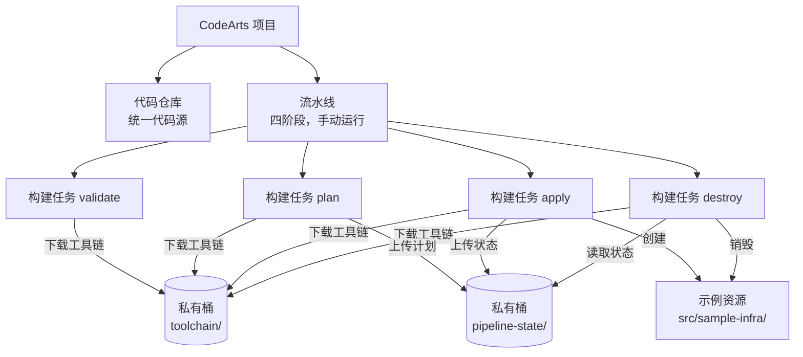

# Terraform 基础设施四阶段流水线实践

[](LICENSE)
[](https://www.huaweicloud.com)

用代码托管、构建与编排服务搭一条四阶段的 Terraform 流水线：校验、计划、应用、销毁。
工具链不预装在构建机上，而是从私有桶按需取回并离线初始化。
适用于希望把 Terraform 变更纳入受控流程、又不想在构建机镜像里固化工具版本的团队。

## 简介

Terraform 进流水线有三处容易做歪：**工具链从哪来**、**阶段之间怎么交接**、**销毁怎么收尾**。
这套实践对三处各给一个明确答案：

- **工具链从私有桶来**：Terraform 与 provider 压缩包放进私有桶，构建机下载后解压，
  按 `registry.terraform.io/huaweicloud/huaweicloud` 的层级生成临时插件镜像配置，
  以 `-plugin-dir` 完成初始化——全程不访问公网，版本由仓库显式声明。
- **阶段之间用对象键交接**：计划阶段把计划文件写到固定对象键，应用阶段读取；
  应用阶段把状态写回另一个固定键，销毁阶段读取。这等于把「阶段间的契约」显式化成两个对象名。
- **销毁只清理示例资源**：示例基础设施独立成目录与独立状态，销毁阶段只作用于它；
  平台资源（项目、仓库、构建任务、流水线、私有桶）保留到人工确认后再释放。

**解决的问题**：把「Terraform 变更从代码提交到资源落地」的受控流程做成一次可部署的最小闭环。

**适用于**：需要为 Terraform 建立审批与执行流程的平台工程团队；
想把基础设施变更纳入既有研发流程、又不愿在构建机里维护工具链的组织。

## 目录

- [架构图](#架构图)
- [方案亮点](#方案亮点)
- [涉及云服务](#涉及云服务)
- [前置条件](#前置条件)
- [快速开始](#快速开始)
- [分步部署](#分步部署)
- [使用方法与验证](#使用方法与验证)
- [仓库结构](#仓库结构)
- [清理资源](#清理资源)
- [详细说明](#详细说明)
- [常见问题](#常见问题)
- [许可证](#许可证)
- [联系方式](#联系方式)

## 架构图



四个阶段共用同一份代码源与同一套构建机配置，差异只在「执行哪条命令、读写哪些对象」。

| 层次 | 承担的服务 | 说明 |
|-|-|-|
| 项目与源码 | CodeArts 项目、CodeArts 仓库 | 代码源与流水线容器 |
| 编排 | CodeArts 流水线 | 四阶段按序执行，手动运行，并发数 1 |
| 执行 | CodeArts 构建 | 四个构建任务，架构 `x86-64` |
| 工具链与状态 | 对象存储服务 | 私有桶承载两个工具链对象与两个状态对象 |
| 示例资源 | 云日志服务 | 一个日志组，用于验证阶段串联 |

## 方案亮点

- **工具链版本由仓库声明**：不依赖构建机镜像预装，换版本只替换桶内两个压缩包。
- **离线初始化**：构建机只从私有桶取包并生成临时插件镜像配置，不访问公网。
- **阶段契约显式化**：计划与状态以固定对象键交接，复跑时传入同一份对象即可重放同一决策。
- **销毁范围可控**：示例资源独立成目录与状态，销毁阶段不会波及平台栈。
- **手动运行防误触**：避免「初始化仓库」这个动作本身触发下一轮运行。
- **阶段模板合一**：公共部分（取工具链、解压、生成镜像配置）只写一份，差异由参数表达。

## 涉及云服务

| 云服务 | 本实践中的职责 | 对应 Terraform 资源 |
|-|-|-|
| CodeArts | 项目、代码仓库、四个构建任务、一条流水线 | `huaweicloud_codearts_project`、`huaweicloud_codearts_repository`、`huaweicloud_codearts_build_task`、`huaweicloud_codearts_pipeline` |
| 对象存储服务 | 私有桶、两个工具链对象 | `huaweicloud_obs_bucket`、`huaweicloud_obs_bucket_object` |
| 云日志服务 | 示例资源：一个日志组 | 在 `src/sample-infra/` 中声明 |

确认不再需要本实践后，及时释放上述资源，避免残留。

## 前置条件

**账号与权限**

- 已开通账号并完成实名认证，可用区域为 `cn-north-4`（本实践在该区域验证）。
- 具备 CodeArts 项目、代码仓库、构建、流水线与对象存储的开通与操作权限。
- 在「我的凭证」页面获取 Access Key ID 与 Secret Access Key，填入部署脚本；
  不要把凭据写入代码或提交到仓库。

**工具与版本**

- Terraform CLI `>= 1.9 且 < 2.0`，huaweicloud Provider `1.95.0`。
- Python 3.9 及以上（运行初始化与验证脚本）。

**离线工具链**

- 两个压缩包需随仓库分发：Terraform `1.9.8`（linux amd64）与 huaweicloud Provider `1.95.0`
  （linux amd64）。它们位于 `src/dist/`，由根工程上传到私有桶。

**区域与命名约束**

- `var.prefix` 决定全部资源名，须小写字母开头、可含数字与连字符、长度 3~32。
- `var.bucket_name` 须全局唯一且符合桶命名规则。

## 快速开始

```bash
# 1. 静态校验
cd infra && terraform init && terraform validate && cd ..

# 2. 填写部署参数并创建平台资源
cd infra
export HW_ACCESS_KEY=<HW_ACCESS_KEY>
export HW_SECRET_KEY=<HW_SECRET_KEY>
export TF_VAR_bucket_name="<全局唯一桶名>"
export TF_VAR_ci_ak="<构建机访问密钥 ID>"
export TF_VAR_ci_sk="<构建机访问密钥 Secret>"
terraform plan -out=cicd.tfplan
terraform apply cicd.tfplan

# 3. 在控制台手动运行流水线，四个阶段按序执行
# 4. 验证
cd ..
python src/scripts/verify_e2e.py
```

## 分步部署

### 第 1 步：静态校验

```bash
cd infra
terraform init
terraform validate
```

预期输出：

```text
Success! The configuration is valid, but there were some
validation warnings as shown above.
```

示例工程同样可以单独校验：

```bash
cd ../src/sample-infra
terraform init -backend=false -input=false
terraform validate
cd ../../infra
```

预期输出为 `Success!`。`-backend=false` 用于跳过后端初始化：示例资源的状态由流水线在桶内生成，
本地校验不需要也不应该产生状态。

### 第 2 步：安全自检（可选）

```bash
python src/scripts/check_security.py
```

脚本检查仓库内是否存在误提交的凭据文件，不访问任何云端接口。

### 第 3 步：填写部署参数

必填三项：

```bash
export HW_ACCESS_KEY=<HW_ACCESS_KEY>
export HW_SECRET_KEY=<HW_SECRET_KEY>
export TF_VAR_bucket_name="<全局唯一桶名>"
export TF_VAR_ci_ak="<构建机访问密钥 ID>"
export TF_VAR_ci_sk="<构建机访问密钥 Secret>"
```

可选参数（完整清单见 `infra/variables.tf`）：

| 变量 | 默认值 | 说明 |
|-|-|-|
| `region` | `cn-north-4` | 部署区域 |
| `prefix` | `tf-cicd-demo` | 资源名称前缀 |
| `repository_branch` | `master` | 仓库默认分支 |
| `python_path` | `python` | 初始化仓库时使用的 Python 可执行文件 |
| `sample_log_ttl_days` | `1` | 示例日志组保留天数，取值 1~365 |

### 第 4 步：创建平台资源

```bash
cd infra
terraform plan -out=cicd.tfplan
terraform apply cicd.tfplan
```

预期输出：

```text
Plan: 11 to add, 0 to change, 0 to destroy.
Apply complete! Resources: 11 added, 0 changed, 0 destroyed.
```

11 个资源包含 1 个项目、1 个仓库、4 个构建任务、1 条流水线、1 个私有桶、2 个桶对象。

应用收尾时会执行一次仓库初始化，把 `src/repository/README.md` 与 `src/sample-infra/` 下的
Terraform 文件提交到新建仓库。

### 第 5 步：查看部署输出

```bash
terraform output
```

常用取值：

```bash
terraform output repository_url            # 仓库地址
terraform output build_task_ids            # 四个构建任务 ID
terraform output toolchain_object_keys     # 构建机下载的工具链对象键
terraform output pipeline_state_object_keys  # 阶段间状态与计划对象键
```

### 第 6 步：运行流水线

在流水线页面点击「运行」。四个阶段按序执行：

| 阶段 | 预期结果 |
|-|-|
| 校验 | `fmt -check` 与 `validate` 无输出即通过 |
| 计划 | 桶内生成 `pipeline-state/sample-infra.tfplan` |
| 应用 | 创建示例日志组，状态写回 `pipeline-state/sample-infra.tfstate` |
| 销毁 | 销毁示例日志组并删除计划与状态对象 |

## 使用方法与验证

### 最简示例：确认四个阶段都成功

```bash
terraform output -json build_task_ids
```

在构建任务页面依次打开四个任务的最近一次执行记录，确认均为成功。
阶段失败时构建日志会给出具体报错行。

### 自动校验

```bash
python src/scripts/verify_e2e.py
```

脚本触发并核对四阶段流水线，把阶段状态、标记行与删除确认写入 `verify-result.json`。
脚本不执行 `terraform apply`，只读取部署输出并驱动流水线运行。

### 核对桶内对象

```bash
export BUCKET="$(terraform output -raw toolchain_bucket_name)"
```

流水线运行后，桶内应保留两个工具链对象：

```text
toolchain/terraform_1.9.8_linux_amd64.zip
toolchain/terraform-provider-huaweicloud_1.95.0_linux_amd64.zip
```

销毁阶段结束后，`pipeline-state/` 下的计划与状态对象应被删除。

### 核对示例资源的生命周期

示例资源是名为 `<prefix>-pipeline-lts-group` 的日志组：

```bash
terraform output sample_log_group_name
```

应用阶段结束后可在日志服务控制台看到它；销毁阶段结束后它应被删除。
这一「出现再消失」的过程正是阶段串联生效的直接证据。

### 重跑仓库初始化

若初始化未完成，可单独重跑：

```bash
python src/scripts/bootstrap_repo.py
```

预期输出提交成功的文件清单。脚本从仓库根目录读取 `src/repository/` 与 `src/sample-infra/`。

**部署完成后请按本节步骤在真实环境自行验证，确认功能可用后方可视为交付完成。**

## 仓库结构

```text
.
├── README.md
├── README.en.md
├── LICENSE
├── docs/
│   ├── architecture.md          四阶段设计、数据流与关键取舍
│   └── deployment-guide.md      分步部署命令与每步预期输出
├── infra/
│   ├── versions.tf              Terraform 与 Provider 版本约束
│   ├── variables.tf             输入变量
│   ├── locals.tf                阶段参数、对象键与仓库文件映射
│   ├── main.tf                  项目、仓库、构建任务、流水线、私有桶
│   ├── outputs.tf               对外输出
│   └── terraform.tfvars.example 输入示例
└── src/
    ├── dist/                    离线工具链压缩包
    ├── repository/              推送到代码仓库的说明文件
    ├── sample-infra/            示例基础设施（单个日志组）
    ├── templates/               阶段脚本模板
    └── scripts/
        ├── bootstrap_repo.py    仓库初始化
        ├── check_security.py    凭据误提交自检
        └── verify_e2e.py        流水线校验
```

## 清理资源

分两步。

**第一步：由流水线清理示例资源。** 运行一次完整流水线，`destroy` 阶段会销毁示例日志组
并清理桶内的计划与状态对象。

**第二步：清理平台资源。**

```bash
cd infra
terraform destroy
```

预期输出：

```text
Destroy complete! Resources: 11 destroyed.
```

私有桶声明了 `force_destroy`，销毁时会连带清理桶内对象（含手动上传的文件）。

## 详细说明

- 四阶段设计、端到端数据流与关键取舍：[docs/architecture.md](docs/architecture.md)
- 从零到可验证部署的完整命令与预期输出：[docs/deployment-guide.md](docs/deployment-guide.md)
- 英文版说明：[README.en.md](README.en.md)

## 常见问题

**构建在准备工具链阶段失败。**
桶内是否存在 `toolchain/` 下的两个对象；对象键是否与 `terraform output toolchain_object_keys` 一致。

**构建报初始化失败。**
插件镜像目录层级是否与 `registry.terraform.io/huaweicloud/huaweicloud` 匹配；`-plugin-dir` 是否指对。

**构建机报权限不足。**
核对 `ci_ak` / `ci_sk` 是否具备桶读写与服务调用权限。

**计划阶段通过但应用阶段失败。**
检查计划对象是否已上传；应用阶段是否读到了同一份对象。

**销毁阶段报状态不存在。**
首次运行未走到应用阶段，属预期——状态对象在应用阶段才生成。

**仓库初始化失败。**
核对 `python_path` 与仓库 ID；凭据是否具备仓库写入权限。

**流水线没有自动触发。**
属预期：流水线只配置手动运行。需要自动触发时在控制台按分支策略单独开启。

**每次应用都提示构建步骤变更。**
检查是否改动了插件模块标识或步骤参数；版本号已让出所有权，不应产生差异。

## 许可证

本实践采用 MIT No Attribution 许可证发布，详见 [LICENSE](LICENSE)。

## 联系方式

创建与维护团队：公有云持续运营部。

使用中遇到问题请在本仓库提交议题，我们会定期查看。
