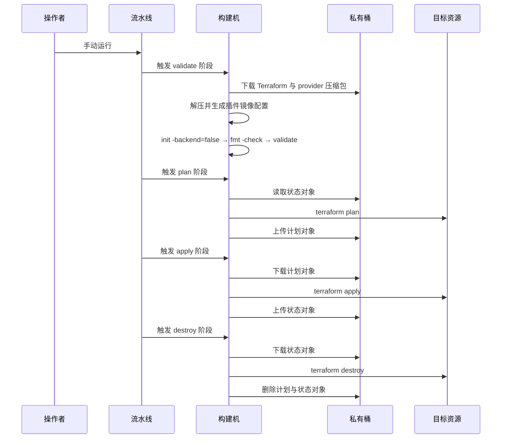
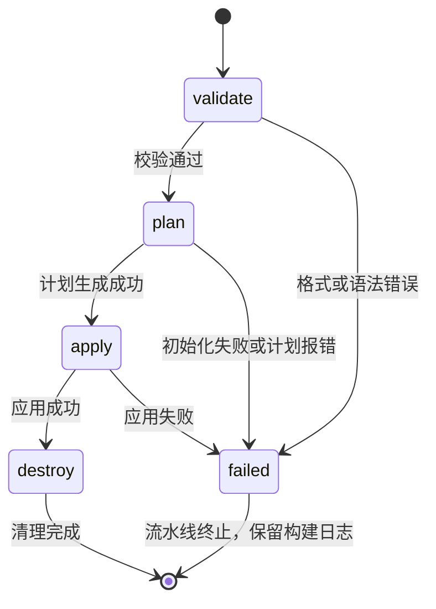
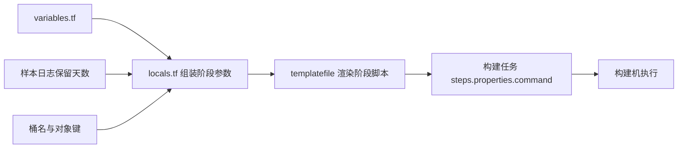

# 架构与技术设计

本文说明本实践的四阶段 Terraform 流水线架构、端到端数据流与关键设计取舍。
部署命令见 [deployment-guide.md](deployment-guide.md)，功能概览见仓库根目录 `README.md`。

## 1. 分层与职责

| 层 | 职责 | 落地位置 |
|-|-|-|
| 平台层 | 项目、代码仓库、四个构建任务、一条流水线 | `infra/main.tf` |
| 工具链层 | 离线 Terraform 与 provider 压缩包的分发 | `infra/main.tf` 的桶对象 + `src/dist/` |
| 执行层 | 四个阶段的构建机命令 | `src/templates/build_stage.sh.tftpl` |
| 状态层 | 阶段之间传递的计划与状态对象 | 私有桶的固定对象键 |
| 示例层 | 被流水线创建与销毁的示例资源 | `src/sample-infra/` |

## 2. 组件清单

### 2.1 平台资源（`infra/main.tf`）

| 资源 | 说明 |
|-|-|
| 项目 | 承载仓库、构建任务与流水线的容器 |
| 代码仓库 | 四个阶段共用的代码源；初始化由 `src/scripts/bootstrap_repo.py` 完成 |
| 构建任务 ×4 | `validate`、`plan`、`apply`、`destroy`，架构 `x86-64` |
| 流水线 | 四阶段按序执行，只配置手动运行，并发数 1、超出时排队 |
| 私有桶 | 承载离线工具链与阶段间状态 |
| 桶对象 ×2 | Terraform 与 provider 的 Linux x86-64 压缩包 |

### 2.2 四个阶段

| 阶段 | 命令要点 | 产物 |
|-|-|-|
| Validate | 取工具链 → `terraform init -backend=false` → `terraform fmt -check` → `terraform validate` | 无持久产物 |
| Plan | 取工具链 → 初始化后端 → `terraform plan -out` → 上传计划文件 | 桶内计划对象 |
| Apply | 取工具链 → 下载计划或重新计划 → `terraform apply` → 上传状态 | 桶内状态对象 |
| Destroy | 取工具链 → 下载状态 → `terraform destroy` → 清理对象 | 清理确认 |

阶段之间通过固定对象键交接：`pipeline-state/sample-infra.tfplan` 与
`pipeline-state/sample-infra.tfstate`。

### 2.3 构建机内的工具链装配

构建机不预装 Terraform。阶段脚本执行三步：

1. 从私有桶下载两个压缩包到工作目录。
2. 解压出 `terraform` 可执行文件与 provider 插件目录，并按 `registry.terraform.io/huaweicloud/huaweicloud`
   的目录层级生成临时插件镜像配置。
3. 以 `-plugin-dir` 指向该镜像目录完成初始化，全程不访问公网。

### 2.4 示例基础设施

`src/sample-infra/` 只声明一个日志组，用于验证「创建 → 计划 → 应用 → 销毁」这条阶段链。
它以独立的初始化目录与状态对象运行，与根工程的状态互不影响。

## 3. 端到端数据流

### 3.1 一次手动运行的完整时序

### 3.2 阶段失败的处理

任一阶段失败即终止后续阶段；计划与状态对象保留在桶内，便于按同一份输入复跑。

### 3.3 构建步骤的参数下发

阶段脚本以单一模板 `src/templates/build_stage.sh.tftpl` 渲染，阶段差异由参数控制，
避免把长脚本拆散到多个构建参数中。

## 4. 运行期配置契约

| 输入 | 用途 |
|-|-|
| `region` | 部署区域 |
| `prefix` | 资源名称前缀 |
| `bucket_name` | 私有桶名（全局唯一） |
| `repository_branch` | 仓库默认分支 |
| `ci_ak` / `ci_sk` | 构建机访问对象存储与服务接口的凭据（敏感） |
| `python_path` | 初始化仓库时使用的 Python 可执行文件 |
| `sample_log_ttl_days` | 示例日志组保留天数 |

阶段脚本从构建任务参数接收：`STAGE`、`REGION`、`BUCKET`、`TERRAFORM_OBJECT_KEY`、
`PROVIDER_OBJECT_KEY`、`STATE_OBJECT_KEY`、`PLAN_OBJECT_KEY`、`LOG_GROUP_NAME`、
`TTL_IN_DAYS` 与凭据。

## 5. 关键设计取舍

### 5.1 为什么把工具链放进私有桶而不是预装

构建机镜像的预装内容随服务侧版本变化，且不同架构需要不同二进制。
把 Terraform 与 provider 压缩包放进私有桶后，工具链版本由仓库显式声明，
构建机只需 `unzip` 与 `chmod`，任何架构上都能复现同一套工具链。

### 5.2 为什么阶段之间用对象键交接

四个阶段运行在四次独立的构建任务里，工作目录不共享。
用固定对象键在私有桶中交接计划与状态，这等于把「阶段间的契约」显式化为两个对象名：
计划阶段产出、应用阶段消费；应用阶段产出、销毁阶段消费。
这也让复跑变得确定——传入同一份对象即可重放同一决策。

### 5.3 为什么四个阶段模板合并为一个

四个阶段的差异只在「执行哪条 terraform 命令、读写哪些对象」，
其余（取工具链、解压、生成插件镜像、初始化）完全一致。
合并后公共部分只有一份，阶段差异由参数表达；代价是模板里多了一层条件分支。

### 5.4 为什么流水线只配置手动运行

流水线首次运行会初始化仓库并提交示例代码。若开启代码推送触发，
「初始化仓库」这个动作本身就会触发下一轮运行，形成意外执行。
因此只保留手动运行；需要自动触发时在控制台按分支策略单独开启。

### 5.5 为什么示例资源独立成目录

示例资源由流水线自己创建与销毁，若与根工程放在同一份声明里，
`destroy` 阶段会连同平台资源（项目、仓库、构建任务、流水线）一起删除。
分成两个目录、两套状态后，`destroy` 阶段只作用于示例资源，
平台栈保留到人工确认后再释放。

### 5.6 为什么不创建独立加密密钥

制品桶为私有桶，对象加密由服务侧托管。为样例单独创建密钥只增加一个需要轮换与授权的对象，
不改变数据可见性边界——可见性由桶策略与凭据共同决定。

## 6. 扩展点

- **加阶段**：在 `local.stage_order` 与 `local.stage_labels` 增加一项，并在模板里补分支。
- **换工具链版本**：替换 `src/dist/` 下两个压缩包，同步 `local` 中的对象键。
- **换示例资源**：替换 `src/sample-infra/` 的内容，阶段脚本无需改动。
- **开自动触发**：在流水线的触发配置里按分支策略开启。
- **接入临时凭据**：把 `ci_ak` / `ci_sk` 换成令牌换取逻辑，构建脚本的其余部分不变。
